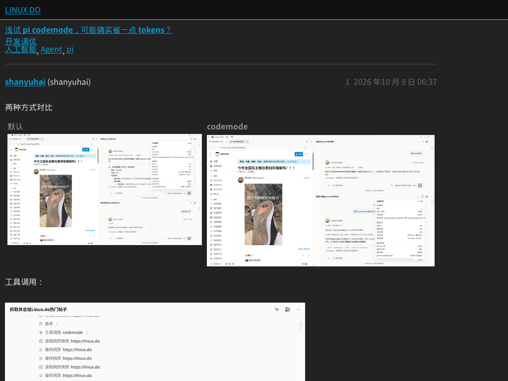

# quickjsbrowser

Cloudflare Workers 上的 QuickJS/WASM 浏览器服务：QuickJS 执行脚本，linkedom 提供 JavaScript DOM，Blitz 负责 HTML/CSS 布局和截图。提供 HTTP API 与 CDP 子集。

## 真实 Worker 验证状态

目标：[linux.do/t/topic/2999210](https://linux.do/t/topic/2999210)，标题「浅试 pi codemode，可能确实省一点 tokens？」。通过指定 SNI 中继访问，1024×768，页面 JavaScript 启用。

**线上完整流程仍未通过，PR #4 保持草稿，尚未合并 main。** 当前部署为 `deca889d-d769-4666-99a5-34d79756b23c`，运行代码 `9e8bb02`。该次真实加载在资源与应用启动阶段触发平台内存超限，CDP continue 超时，尚未完成 A → B → A、点击和返回验收。

Cloudflare 按独立 DO 记录的本次失败尝试累计 CPU 为 **10.709972 秒**，CPU 超限 0、内存超限 2，平台采样的 isolate 峰值 **242,134,549 字节**。这不是完整成功启动的耗时，不能宣称十秒目标达标。

已实现混合 SNI/直连路由、同一 DO 的有界资源缓存、按需动态导入、补齐当前启动链所需的浏览器能力，以及 QuickJS 源码位置索引、WASI 内存计量和跨导航线性内存复用。14 个本地套件和六个渲染 case 通过；另一个真实 Worker 网络探针确认 Linux.do、Stripe、Google 均可取回 200。局部回归与本地真实资源重放不替代线上完整应用通过。

实现与复现见[会话缓存及路由说明](docs/browser-cache-routing.md)，完整现状和失败证据见[真实站点报告](docs/real-site-2999210.md)。

<details>
<summary>历史截图：旧版加载屏与静态回退，均不代表当前完整应用成功</summary>




</details>

## 本次修复

行内浮动元素会让旧渲染器卡在 Parley 断行循环，直至 Durable Object CPU 超限。最小复现：

```html
<p><span style="float:left">X</span>Text</p>
```

修复在 Rust 渲染层：

- 明确启用 `blitz-dom/floats`，让 `InlineBoxBreak` 进入真实的浮动放置与状态推进逻辑。
- 修正构建器的功能开关：未启用 floats 时，不产生需要浮动处理器的特殊盒子。
- 给断行循环加入基于文本与盒子数量的进度预算，避免未来状态不前进时无限消耗 CPU。

没有通过删除 CSS、修改页面的 float 样式或提高 CPU 上限来绕过问题。

## Codespaces 开发

打开本仓库的 Codespace。环境需要 Node 24、Rust ≥1.91、libclang、pkg-config；devcontainer 配置提供基础安装。构建脚本会安装 WASM target 与匹配版本的 wasm-bindgen CLI。

```bash
npm ci
npm test
npm run build
npm run build:renderer
npm test
```

仓库包含构建好的运行资产，便于克隆后直接验证。重新构建时：

- QuickJS 固定为 `84e723f1ace5e3823cef8149dd0f890fe74b77ce`，WASI SDK 25。
- Blitz 固定为 `4507cd7e2261a439e727aacc0a65cb1d3a2434f9`，本地补丁由 `scripts/patch-blitz.py` 幂等应用。
- Rust 依赖由 `renderer/Cargo.lock` 锁定，wasm-bindgen CLI 固定为 0.2.100。

`npm test` 会运行十组本地套件和独立进程中的浮动回归测试。每个渲染案例有超时，覆盖最小复现、块级浮动、左右浮动位置差异，以及外链 CSS。

## 部署与线上验证

使用安装好的 Wrangler 二进制，不使用 npx 或 wrangler dev。先通过全部本地测试，再部署到真实 Workers 环境。

将 `KEY` 配置为 Cloudflare secret。`RELAY_IP` 和 `DEEPLX_URL` 为可选的私有部署配置；不要将实际值提交到仓库。Wrangler 的认证使用环境变量或登录状态。

```bash
npm test
npm run deploy
```

设置 `QJSB_BASE` 和 `QJSB_KEY` 后：

```bash
npm run test:remote
```

线上测试使用新的随机会话，依次验证最小浮动页面、example.com 和 linux.do 帖子，保存 PNG 与耗时记录到 `.cache/cdp-smoke/`。也可给 `test/cdp-smoke.mjs` 传入自定义 URL。

## 主要目录

- `src/`：Worker、Durable Object、QuickJS 宿主面、CDP 与网络层。
- `renderer/`：可重建的 Rust 静态渲染边界，页面 JS 仍在 QuickJS 中执行。
- `engine/`：QuickJS C ABI 与 WASI 构建。
- `scripts/`：固定依赖获取、渲染器补丁与构建。
- `test/`：本地套件、浮动回归和线上 CDP 验证。

CDP 仍是子集：对象句柄、多页面隔离、完整 Network 事件等尚未实现。会话主要保存在 DO 内存中。

## Performance-bounded page scripts

Small page applications can use import maps, real DOM observers and bounded asynchronous work. Script inputs, subrequests and execution have explicit budgets; degraded and noscript fallback output is reported to clients. See [capabilities and limits](docs/bounded-browser-capabilities.md) and [deployed validation](docs/bounded-browser-validation-2026-10-16.md).


## Explicit relay configuration and interactive CDP

Open a CDP session with `?proxy=IP%3Aport`, or send the project-specific command
`Browser.setProxy({ip, port})` before navigation. This wraps the project's existing
self-implemented SNI/TLS relay as a browser proxy. The endpoint does not need to
speak HTTP CONNECT or SOCKS5. SNI requests use the relay first; failed GET/HEAD
requests may use native direct fetch. Successful direct origins are remembered
for five minutes. Explicit HTTP CONNECT and SOCKS5 proxies remain strict.

The default viewport is 1024×768. Computed style and geometry query Blitz;
coordinate mouse events run page handlers and ordinary links navigate.
See [usage, design and limits](docs/session-browser-flow.md) and
[local/deployed validation](docs/session-validation-2026-10-16.md).
