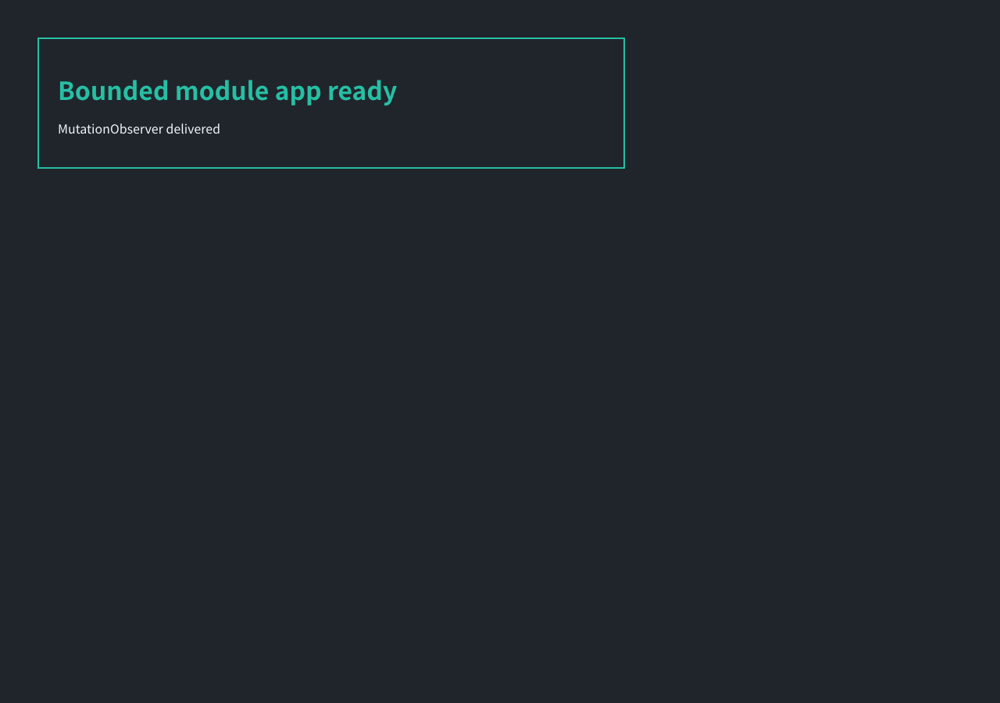

# Performance-bounded browser validation, 2026-10-16

Deployed version: `23c90c28-256a-4f30-8d07-6f9048859565`. Source commit: `1499af7`.

The small module application imports a mapped dependency, changes its DOM and receives a real MutationObserver notification. Oversized sources and runaway execution are declined. A preflight refusal does not rebuild an untouched VM or repeat trusted automation. If page code has run, failure discards its partial DOM and pending jobs.

## Deployed CDP checks

| Case | Navigate | Capture | Result |
| --- | ---: | ---: | --- |
| linux-fast | 978 ms | 1117 ms | static; noscript fallback |
| linux-bounded | 691 ms | 581 ms | degraded; noscript fallback |
| example | 137 ms | 206 ms | executed |
| module-app | 534 ms | 143 ms | executed |
| oversized | 148 ms | 169 ms | degraded |
| loop | 323 ms | 149 ms | degraded |

## Direct HTTP screenshots

| Case | Complete receive | Result |
| --- | ---: | --- |
| module-app-http | 1485 ms | scripted:executed |
| linux-fast-http | 2815 ms | fallback:static |
| linux-bounded-http | 3233 ms | fallback:degraded; request-budget |

The known linux.do noscript image has SHA-256 `82b0cef96dab419bfd6556894526cbeccf8fc54682e41034bd67ee7e491e776a`. Successful final linux.do images:
- `linux-fast`: `82b0cef96dab419bfd6556894526cbeccf8fc54682e41034bd67ee7e491e776a`
- `linux-bounded`: `82b0cef96dab419bfd6556894526cbeccf8fc54682e41034bd67ee7e491e776a`
- `linux-fast-http`: `82b0cef96dab419bfd6556894526cbeccf8fc54682e41034bd67ee7e491e776a`
- `linux-bounded-http`: `82b0cef96dab419bfd6556894526cbeccf8fc54682e41034bd67ee7e491e776a`

The complete Discourse sidebar/avatar/timeline application is still outside the budget. Its bounded attempt can decline the script manifest before any script subrequests or compilation; returned fallback output is explicitly labelled. Network variability may cause a document deadline failure rather than an image.

## CPU evidence

Platform CPU below covers the main Durable Object call; CDP records include navigation and capture, not screenshot-only CPU. Records are matched to this deployed version and diagnostic session.

| Case | CPU | Platform wall | Outcome |
| --- | ---: | ---: | --- |
| linux-fast | 1798 ms | 2790 ms | ok |
| linux-bounded | 992 ms | 1616 ms | ok |
| example | 482 ms | 855 ms | ok |
| module-app | 411 ms | 969 ms | ok |
| oversized | 467 ms | 650 ms | ok |
| loop | 681 ms | 843 ms | ok |
| module-app-http | 538 ms | 592 ms | ok |
| linux-fast-http | 1657 ms | 2231 ms | ok |
| linux-bounded-http | 2011 ms | 2630 ms | ok |

## Validation

All 129 existing assertions, four navigation regression groups, ten capability groups and six renderer cases plus float/CSS assertions passed. They cover real CDP script toggling, lexical imports, native module alias linking, DOM observer delivery, preserved initialization JSON, source/operation/task budgets, unhandled rejections and cancellation of stalled document/relay connections.

See [capabilities, budgets and remaining limitations](bounded-browser-capabilities.md).
