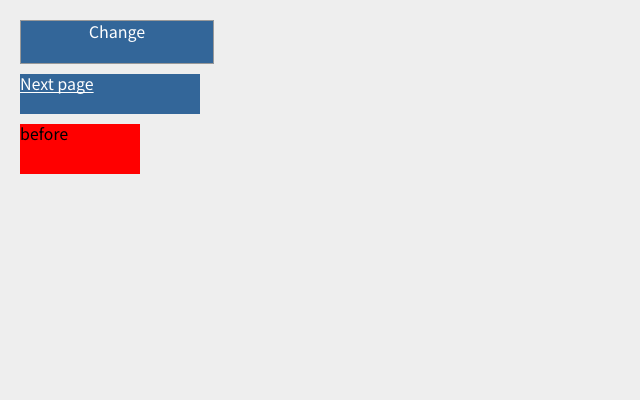
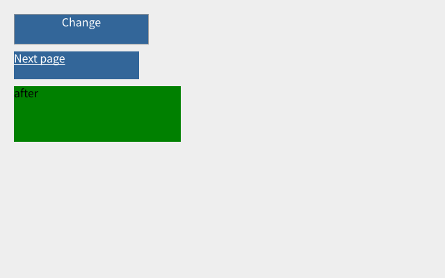
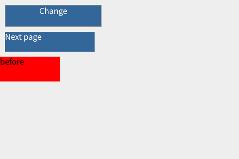
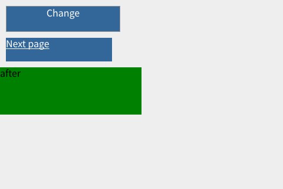

# Interactive CDP validation — 2026-10-16

Branch: `browser-session-flow`. Local regression and real Cloudflare Worker validation are recorded below.

- Both QuickJS C/WASM and Rust renderer WASM rebuilt successfully.
- Final `npm test` exit code: 0. All nine local suites and six renderer cases passed, including float direction and external CSS assertions.
- An actual WebSocket CDP connection loaded HTML, CSS and JS through an HTTP CONNECT proxy with authentication.
- Computed CSS color/width, viewport-relative resize and synchronous layout reads matched the fixture.
- Coordinate clicks changed DOM, geometry and PNG output; ordinary links navigated and returned.
- Cancellation, timer navigation without an extra command, old-document timer isolation and relative page fetches passed.
- Proxy failure made zero direct requests. SOCKS5 fragmented negotiation and authentication passed.
- A separate real HTTPS example.com request through HTTP CONNECT passed using native TLS and certificate validation in Node's socket shim.

The changes are deployed. Full Discourse, Puppeteer selector-based clicking and complete browser compatibility are not claimed. Native HTTPS tunnel behavior for optional standard-protocol proxies is separate from the custom relay verified here.

## Real Worker validation

- Deployed code: `ab2f847`; Worker version: `3fe02843-ced7-4246-af35-94487fe441ff`.
- All five checks passed using fresh public CDP WebSocket sessions on the deployed Worker.
- Interactive fixture: navigation 608 ms; screenshots before/after/link navigation 96/47/49 ms. Assertions checked CSS width 120→240, changed text and different PNGs.
- The external module application loaded and executed its module graph, delivered MutationObserver records and produced a screenshot.
- The example.com page executed its current script and rendered. Its script changes the body, so the check uses the document title and IANA destination instead of assuming an old body heading survives.
- A bare `proxy=IP:port` selected the existing custom SNI/TLS transport. `Browser.setProxy({ip,port})` selected the same route. No HTTP CONNECT or SOCKS endpoint was required.
- An invalid bare relay endpoint failed navigation with the route still set to `sni`; it did not fall back to direct access.
- The existing explicit relay loaded linux.do and produced a styled article image. This remains the noscript article fallback, not a full Discourse client. The final sample hit the render-resource window (`resources: limited`); an earlier sample completed its resource loads. This is reported rather than labelled fully loaded.

These wall times are samples, not performance guarantees. The fixtures below are actual Worker screenshots.






Reproduce with `QJSB_KEY` and optionally `QJSB_RELAY_IP` in a private environment:

```sh
npm run test:browser-flow:remote
```

## Captured fixture images

Before clicking:



After clicking the change button (red 120px box becomes a green 240px box):



After clicking the navigation link:


