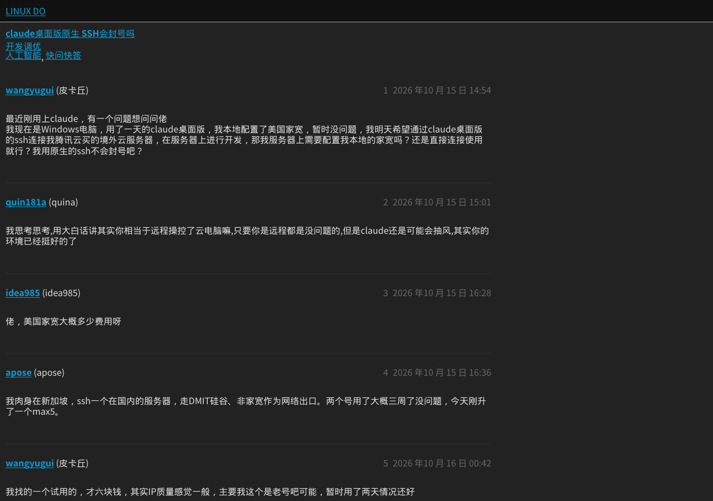

# 2026-10-16 构建、部署与回归记录

部署版本：`b21fd4f0-6b1b-4520-9672-1467945af26f`。部署于 2026-10-16T04:54:13.554158+00:00。

构建环境：GitHub Codespaces；Node 24.21.0、Rust 1.99.1、WASI SDK 25、wasm-bindgen 0.2.100、Wrangler 4.151.0。

## 验证结果

- QuickJS 从固定版本源码重新编译。
- Rust 渲染器从固定版本 Blitz 源码重新编译，启用 floats 并应用仓库内补丁。
- 原有六组本地套件：11 + 51 + 19 + 28 + 8 + 12 = **129 pass / 0 fail**。
- 六个独立渲染案例及浮动位置、外链 CSS 断言全部通过。
- Wrangler 部署打包检查通过，实际部署成功。

| 公网 CDP 场景 | 导航墙钟 | 截图墙钟 | PNG 字节 | 结果 |
| --- | ---: | ---: | ---: | --- |
| minimal inline float | 0.023s | 0.220s | 7581 | PASS |
| https://example.com | 0.067s | 0.480s | 57046 | PASS |
| https://linux.do/t/topic/3029893 | 16.256s | 1.117s | 106453 | PASS |

上述测试使用全新随机会话，没有注入 float:none、移除 CSS 或扩大 CPU 上限。

平台查询返回的回归会话记录均为 ok，未出现 CPU 超限重置。linux.do 会话中最大单条请求归属 CPU 记录为 13.563s，包含导航与截图等工作，不能当作截图函数单独的 CPU 耗时。

## 首页的独立失败结果

额外测试 https://linux.do/ 时，导航返回 HTTP 错误。HTTP 截图接口进一步确认上游 HTTP 403 且 cf-mitigated: challenge；直连和现有反代均返回 403。该请求未进入截图渲染，因此本报告没有将首页列为通过。

## 截图

下图来自保留原页面样式的公网 CDP 截图。

## 构建资产 SHA-256

- `src/engine.wasm`：`631aee96139b83c5a6c863e7343abe7b9179c838925a16b6cd8cd14de8dce8e9`
- `src/vendor/pkg/kitesurf_clone_bg.wasm`：`b67bd553298983c82e37073b0725a742b03b3c4a872dec98d572b23a0d937f4f`
